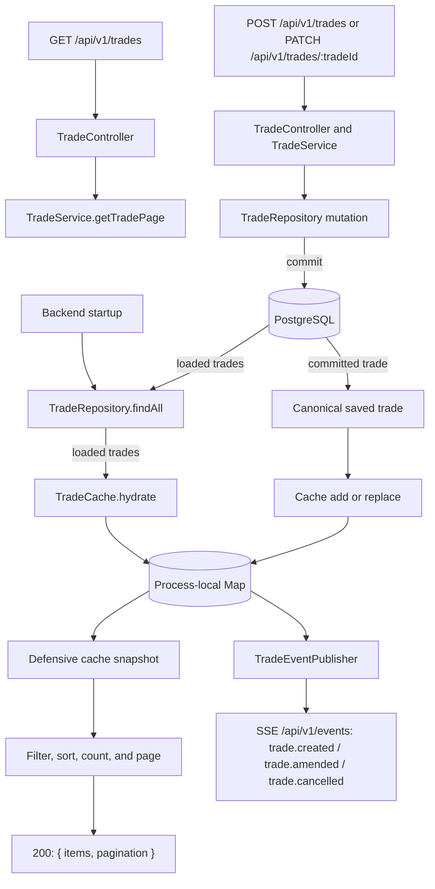
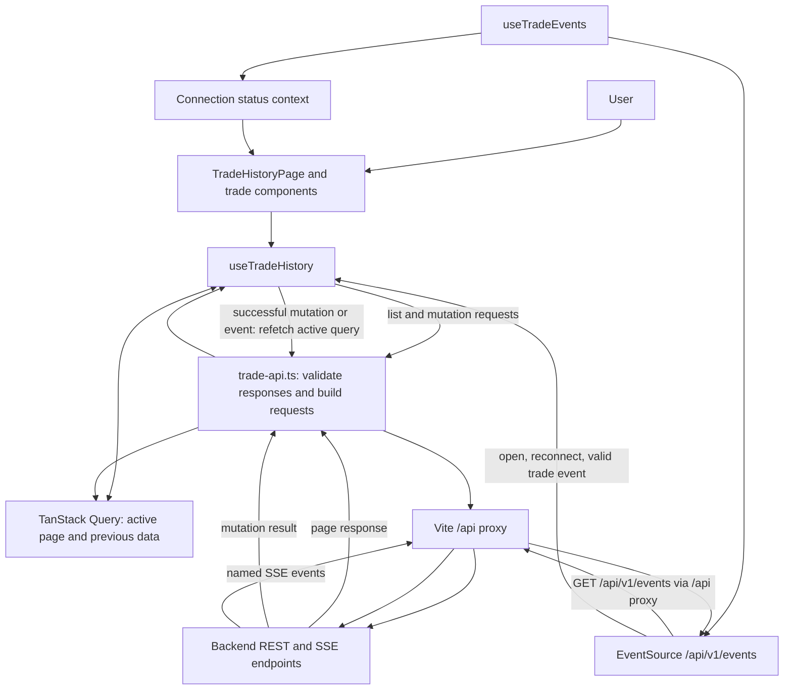
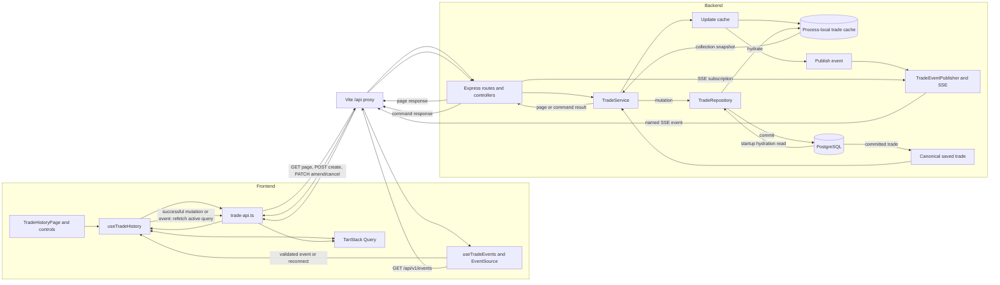

# Fusion Platform

A small full-stack trading platform take-home project. The repository is organized as a monorepo with separate `frontend` and `backend` packages, plus a PostgreSQL service and shared local-development tooling.

## Architecture

- `frontend/`: React, TypeScript, Vite, Tailwind CSS, TanStack Query/Table, React Hook Form, and Zod.
- `backend/`: Express and TypeScript, Prisma/PostgreSQL persistence, Zod/OpenAPI contracts, and Vitest/Supertest tests.
- `database/`: PostgreSQL 16 development image, versioned SQL migrations, idempotent migration/seed shell scripts, and the randomized SQL trade dataset.
- `workspace`: Node 24 development container used by VS Code.
- `docker-compose.yml`: starts the workspace, database, backend, and frontend services.

The backend currently listens on port `4001`; the frontend's Vite server is published on host port `3001`; PostgreSQL is published on port `5432`.

Compose loads backend connection settings from `backend/.env.dev` and frontend settings from `frontend/.env.dev`. The `database` service owns the `SEED_TRADES` and `SEED_TRADES_COUNT` settings. The backend connects to PostgreSQL by its Compose service name; frontend API requests use the Vite `/api` proxy to reach the backend. The frontend does not connect directly to PostgreSQL.

## Data Flow

The backend is the system of record boundary. PostgreSQL is hydrated into a process-local cache at startup; collection reads filter, sort, count, and page a defensive cache snapshot. Mutations commit to PostgreSQL before changing that cache or publishing events. The frontend keeps the active page query in TanStack Query, sends REST requests through Vite's `/api` proxy, and uses SSE only as a signal to refetch the active page. It does not merge event payloads into a partial page.

### Backend (Only)



Startup must connect to PostgreSQL and hydrate the cache before the server listens. `/ready` is healthy only while PostgreSQL is reachable and hydration is complete. Collection queries do not read PostgreSQL per request; direct database writes and writes made by another backend instance are not visible until rehydration. Mutation ordering is database commit, cache update, then event publication.

### Frontend (Only)



Create, amend, and cancel forms submit REST commands through `trade-api.ts`; successful mutations refetch the active numbered query. The event hook validates event payloads and refreshes that same query on valid events, stream open, and reconnect. Event payloads are not upserted into the current page. `TradeHistoryPage` composes the screen and owns dialog state; feature hooks own query/mutation orchestration and EventSource lifecycle.

### Backend + Frontend (Combined)



The combined flow separates commands from notifications: REST responses acknowledge the initiating request, while process-local SSE informs connected browsers that committed data changed. The frontend then requests a fresh, correctly filtered/sorted page. SSE has no IDs or durable replay, so reconnect also refetches; multi-instance cache synchronization and event fan-out are not implemented.

## Architecture Decisions and Trade-offs

### Shared development environment

- Docker Compose defines the workspace, database, backend, and frontend so manual Compose users and VS Code Dev Container users can start the same environment. The trade-off is maintaining container configuration in addition to package scripts.
- Backend and frontend keep separate package manifests; root-level Husky and lint-staged coordinate shared Git hooks without merging app dependencies.

### Backend Decision Analysis and Resolution

**Decision:** The backend is one independently deployable service (a small microservice in deployment terms) and a modular monolith internally. HTTP controllers, trade use cases, the PostgreSQL repository, in-process cache, and SSE event publisher remain modules within that service; they are not split into separately deployed services.

**Source organization:** `backend/src/app.ts` configures Express and `backend/src/server.ts` wires dependencies and manages process startup. Business capabilities live under `backend/src/features/`, including their controllers, services, repositories, and supporting helpers. Shared `types.ts`, `constants.ts`, `schemas.ts`, `errors.ts`, and `middleware.ts` live at `backend/src/`; OpenAPI contracts and documentation routes live under `backend/src/openapi/`.

### Backend Folder Structure

Backend code is organized by feature. The trade feature groups its HTTP layers and supporting domain/infrastructure code; smaller features contain only the layers they need. Shared application concerns stay at `src/`.

```text
backend/
├── src/
│   ├── features/
│   │   ├── trades/
│   │   │   ├── routes/
│   │   │   ├── controllers/
│   │   │   ├── services/
│   │   │   ├── repositories/
│   │   │   └── trade-*.ts             # feature helpers and contracts
│   │   └── health/
│   │       └── controllers/
│   ├── openapi/
│   ├── app.ts                         # Express composition
│   ├── server.ts                      # startup and dependency wiring
│   ├── server-shutdown.ts
│   ├── constants.ts
│   ├── errors.ts
│   ├── middleware.ts
│   ├── schemas.ts
│   └── types.ts
├── prisma/schema.prisma
└── tests/
    ├── features/<feature>/            # API, repository, and service tests
    ├── integration/
    └── openapi/

database/
├── migrations/
├── scripts/
└── seed/
```

Use kebab-case filenames. Add a feature subfolder when it groups related files; keep one-off helpers with their owning feature. Shared HTTP middleware and application types live at `src/`; SQL migrations and seed scripts live under `database/`.

**Responsibilities:**

- Controllers parse HTTP input, validate request schemas with Zod, call a service, and map outcomes to HTTP responses.
- Trade services own use-case coordination and business rules for creating, amending, and cancelling trades.
- The repository owns PostgreSQL writes and startup hydration. PostgreSQL remains the system of record.
- `TradeCache` owns an in-process `Map<TradeId, Trade>` used for cache-backed list filters/sorts/pages after initial hydration and updated by successful writes. List queries operate on a defensive snapshot and do not mutate the Map.
- A typed event publisher emits `trade.created`, `trade.amended`, and `trade.cancelled` after persistence and cache update. The SSE endpoint broadcasts committed trade changes to connected clients. Cancellation is terminal; the backend does not support direct reactivation.

**Startup and read flow:** `setup.sh` applies SQL migrations and optionally seeds an empty database before starting the backend. The backend connects to PostgreSQL and hydrates the complete trade cache before listening. `GET /ready` reports HTTP `200` only while PostgreSQL responds and cache hydration is complete; otherwise it returns `503`. Compose uses readiness before starting dependent services. `GET /api/v1/trades` reads a defensive snapshot of the process-local cache, then applies validated filters, allow-listed sorting, and numbered offset pagination without a page-query database round trip. It returns `{ items, pagination: { page, pageSize, totalItems, pageCount } }`; the filtered total is computed from the same cache snapshot. Sort order always includes a deterministic ID tie-breaker. SSE events trigger a refetch of the current query rather than merging into a partial collection. Cache updates follow successful writes made through this process; direct database writes and writes through other backend instances are not reflected until rehydration. If startup hydration fails, the service does not begin serving.

**HTTP contracts and traceability:** JSON REST errors use `{ error: { code, reason, requestId } }`, with `details: [{ field, reason }]` for invalid fields. A server-generated `X-Request-Id` accompanies both successful and failed responses and correlates with structured request/error logs. Request logs record normalized routes rather than raw URLs or query values. API changes are reflected in the OpenAPI document served at `/api-docs/openapi.yaml` and Swagger UI at `/api-docs/`. The frontend consumes the trade collection and event stream.

**Security, logging, and payloads:** Helmet is applied globally for security headers. Its CSP permits the inline scripts and styles Swagger UI requires; `upgrade-insecure-requests` is enabled only in production so the HTTP development server can load its assets. `pino-http` emits structured request logs to stdout, and unexpected errors are logged with the request ID. Express compression negotiates gzip for sufficiently large compressible responses; the SSE route is excluded to avoid delaying streamed events. Logs are not stored in PostgreSQL or application-managed files; retention and shipping belong to the container/runtime environment. The backend currently has no authentication, rate limiter, or API gateway because these are not assessment requirements.

**Exploring the API:** Open <http://localhost:4001/api-docs> on the configured backend port. Swagger UI uses that same origin for "Try it out"; no additional service or port is needed. Active trades can be amended with editable fields or cancelled with `{ "status": "CANCELLED" }` through `PATCH /api/v1/trades/{tradeId}`. A cancelled trade cannot be directly returned to `ACTIVE`. The SSE operation documents `trade.created`, `trade.amended`, and `trade.cancelled`, their JSON payloads, wire format, reconnect delay, and recovery limitations. Swagger UI is not a live event viewer: use `curl -N http://localhost:4001/api/v1/events` or a browser `EventSource`. Events have no IDs or durable replay; valid events and reconnects refetch the active server query.

**Mutation flow:** The controller validates the request; the service applies domain rules; the repository commits to PostgreSQL and returns the saved trade; the service then updates the Map synchronously and publishes the corresponding event. A persistence failure must leave the cache unchanged and publish no event. SSE delivery failures must not turn an already-committed HTTP mutation into a failure. During shutdown, the backend stops accepting requests, ends active SSE streams and releases their subscriptions, waits for HTTP connections to close, then disconnects Prisma.

**Cache trade-off:** Page size bounds response transfer and browser memory, but filtering/sorting the in-memory snapshot costs O(n) or O(n log n) per request, and the backend still holds all trades in a process-local Map. This is appropriate for the configured 100–1,000 trade development dataset and avoids a network round trip per list request. PostgreSQL remains authoritative for writes and is the source used on startup; the cache is disposable, process-local, and does not observe direct or other-instance writes until rehydrated.

### Real-Time Transport Decision

| Option                   | Strengths                                                                                                                | Trade-offs for this application                                                                                                                                                                          |
| ------------------------ | ------------------------------------------------------------------------------------------------------------------------ | -------------------------------------------------------------------------------------------------------------------------------------------------------------------------------------------------------- |
| Server-Sent Events (SSE) | Built on HTTP; browsers provide `EventSource` with automatic reconnect; simple server-to-client named events.            | One-way only; event payloads are text; reconnect does not recover missed events unless the server implements event IDs and replay. This implementation uses no IDs or durable replay.                    |
| Native WebSocket         | Full-duplex communication with low framing overhead; useful when clients and server both need to send frequent messages. | Requires a custom application protocol, reconnect/backoff, heartbeat, and recovery behavior. Those add complexity while trade commands already use REST.                                                 |
| Socket.IO                | Higher-level rooms, acknowledgements, reconnect handling, and transport fallback features.                               | Requires the Socket.IO protocol and matching client/server libraries; adds dependencies and abstraction beyond the current one-way update need. It is not interchangeable with a plain WebSocket client. |

**Decision:** Use SSE for committed trade notifications because the browser sends commands through REST and only needs server-to-client updates. Native `EventSource` keeps the client simple and reconnects automatically; WebSockets or Socket.IO would be reconsidered if bidirectional messaging, rooms, or acknowledgements become requirements.

The backend publishes `trade.created`, `trade.amended`, and `trade.cancelled` only after persistence and cache update. The frontend opens the stream before fetching its initial page. Valid events trigger a refetch of the active server query; they are not merged into a partial page. Reconnect also refetches the active query. Events are process-local and non-durable; missed changes are recovered by fetching again, not replaying the stream.

**Concurrency and alternatives:** Amendments use an atomic active-status condition in PostgreSQL, but do not use version-based optimistic concurrency; concurrent amendments to an active trade may overwrite one another. Redis, distributed caching, and multiple services are deferred because the assessment specifies neither multi-instance scale nor a cache bottleneck. This is a single-process architecture with explicit limits, not a horizontally scaled design.

### Frontend Structure

The frontend keeps app-wide setup separate from feature code. Each feature owns its page, API/schema code, hooks, tests, and reusable UI. The trade feature illustrates the convention:

```text
frontend/src/
├── main.tsx
├── App.tsx                          # providers and application shell
├── components/                      # app-wide components only
├── contexts/
├── index.css
├── features/
│   └── trades/
│       ├── TradeHistoryPage.tsx
│       ├── trade-api.ts / trade-schema.ts
│       ├── useTrade*.ts
│       ├── *.test.tsx
│       └── components/
│           └── <ComponentName>/
│               ├── index.tsx
│               ├── *View.tsx
│               ├── *.stories.tsx
│               └── *.test.tsx
```

Component folders and named component/view/story/test files use PascalCase; `index.tsx` is the component entry point, while feature utilities use kebab-case. Components receive typed data and callbacks; API access and feature orchestration stay in feature files and hooks. Keep a component's stories and tests beside it. `TradeHistoryPage` composes the screen and owns dialog state, while `useTradeHistory` and `useTradeEvents` own query/mutation and SSE behavior. Use the top-level `components/` directory only for UI shared across features.

Use TanStack Query for server-state caching and mutations, React Context for genuinely shared client state, TanStack Table for grid interactions, and React Hook Form/Zod for forms and validation. Do not mirror query-owned trade data in Context. Continue using the Vite `/api` proxy for browser requests. Vite provides development hot module replacement; the production Dockerfile uses Nginx to serve the built static assets.

## Prerequisites

For either Docker-based option:

- Docker Desktop, or Docker Engine with Docker Compose v2.

For the VS Code option:

- Visual Studio Code.
- The Dev Containers extension.

## Run With Docker Compose

From the repository root, run the setup script:

```sh
bash .devcontainer/shell/setup.sh
```

Setup installs dependencies, starts the database, runs `database/scripts/migrate.sh` and `database/scripts/seed.sh` inside the PostgreSQL container, generates the Prisma client, and only then starts the backend and frontend. The backend does not apply migrations or seed data on startup.

Running `docker compose up` by itself does not run migrations or seed data, and may start the backend before the database schema exists. Use the setup script as the entry point. If you already ran `docker compose up`, run `bash .devcontainer/shell/setup.sh`; it stops the app services, applies database setup, then starts them again.

In development, `SEED_TRADES=true` seeds an empty table with 500 trades; set `SEED_TRADES=false` to disable it. `SEED_TRADES_COUNT` can be set from 100 to 1,000. The SQL migration ledger makes setup repeatable, and the seed script skips a non-empty table.

- Frontend: <http://localhost:3001>
- Backend liveness: <http://localhost:4001/health>
- Backend readiness: <http://localhost:4001/ready>
- PostgreSQL: `localhost:5432`

| Setting        | Value              |
| -------------- | ------------------ |
| DB Server name | `database`         |
| Port           | `5432`             |
| Username       | `postgres`         |
| Password       | `postgrespassword` |
| Database       | `fusion_platform`  |
| SSL            | `disable`          |

To stop the stack, press `Ctrl+C` or run `docker compose down` from another terminal. The `postgres_data` volume preserves database files. To remove the volume and its data as well, run `docker compose down --volumes`.

To view service logs:

```sh
docker compose logs --follow database backend frontend
```

## Run In VS Code Dev Containers

1. Clone the repository and open its root folder in VS Code.
2. Install the Dev Containers extension if needed.
3. Run **Dev Containers: Reopen in Container** from the Command Palette.

VS Code uses the Compose configuration in `.devcontainer/devcontainer.json`, attaches to `workspace`, and initially starts only `workspace` and `database`. The setup script applies migrations and seeds before starting the backend and frontend. On subsequent starts, its database-only mode runs the idempotent database scripts before starting the apps.

The same application URLs and local database settings listed above apply. Docker is required for this option as well.

## Run Checks

After dependencies are installed, run these commands from the repository root:

```sh
npm run lint
npm run format:check
npm test
npm run test:all
npm --prefix backend run test:db-integration
```

To build the packages:

```sh
npm --prefix backend run build
npm --prefix frontend run build
```

Pre-commit hooks run ESLint and Prettier on staged files. Pre-push hooks inspect the commits being pushed and run tests only for packages with changed files. Changes outside `backend/` and `frontend/` run both suites because they may affect the whole workspace.

## AI Usage Report

### Tool Used

GitHub Copilot Chat in Visual Studio Code was used as a development aid for targeted code exploration, implementation suggestions, test and documentation updates, and debugging. It contributed to some code and test edits; the project was not produced by one-shot generation.

### How It Was Used

- Copilot assisted with codebase exploration, implementation and refactoring suggestions, tests, documentation, and debugging. Some resulting code and test changes were AI-assisted.
- Reviewed suggestions against the requirements and existing code, then ran the relevant test, lint, and build checks. Responsibility for the final implementation and its acceptance remained with the author.

### Decisions Influenced by AI

Copilot helped compare implementation options and identify trade-offs. AI assistance defined the requirements and scope, selected the application boundaries, and design decisions. Copilot helped carry out those approved decisions; it did not choose or accept them autonomously.
